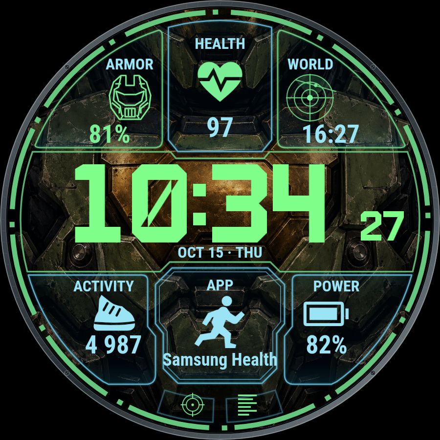

# Wear OS számlapműhely

Az első működő téma a **Spartan Night**, HALO ihletésű natív számlap.
További témák: God of War / Kratos, Gyűrűk Ura / Egy Gyűrű és Star Wars.
Ezek jelenleg dizájn- és fejlesztési tervek, referenciaanyagokkal; nincs hozzájuk APK.

| Téma | Állapot | Részletek |
| --- | --- | --- |
| HALO – Spartan Night | 0.1.5-test, telepíthető teszt-APK | [Letöltések](https://github.com/fuloplevente1998/WearOS-Szamlap/releases), [dizájn](docs/themes/HALO.md) |
| God of War – Kratos | Tervezés | [Dizájnterv](docs/themes/KRATOS.md) |
| Gyűrűk Ura – Egy Gyűrű / Középfölde | Tervezés, két vizuális irány | [Dizájnterv](docs/themes/MIDDLE-EARTH.md) |
| Star Wars | Tervezés | [Dizájnterv](docs/themes/STAR-WARS.md) |

[Fejlesztési irány](docs/ROADMAP.md) · [Fejlesztőkörnyezet](docs/DEVELOPMENT.md) ·
[Kiadási kapuk](docs/RELEASES.md) · [Referenciaanyagok](docs/themes/references/README.md)



Az előnézet a csomagolt grafikákkal készült illusztráció, kézi HUD-jelképekkel.
A működő számlap adatforrásfüggő ikonokat és élő adatokat jelenít meg.

## Spartan Night – működő tesztszámlap

Natív **Watch Face Format 2** számlap Galaxy Watch7-re (Wear OS 5 / Android 14
vagy újabb). Verzió: **0.1.5-test / 6**. Csomagnév: `hu.fuloplevente.spartannight`.
Hat nagy panel és két kis gyorsgomb van, mind a nyolc natív alkalmazás-/adatmező.
Az APK fejlesztői tesztkulccsal aláírt; nem végleges kiadás.

## Automatikus HALO-ikonok – 0.1.5

Az alkalmazás vagy adatforrás cseréjekor a számlap a felismert névhez a saját,
rajzolt HALO-ikonját rendeli. Például Samsung Health / pulzus → szív,
akkumulátor → akkujel, lépések → cipő, TrainPilot / edzés → futó. További
párosítások: időjárás, zene, naptár, ébresztő, időzítő, navigáció és kommunikáció.
Mind a nyolc mező ezt használja. A szolgáltató Android-ikonja nem jelenik meg.

A **Testreszabás → Automatikus HALO-ikonok** alapból bekapcsolt, frissítéskor is.
Kikapcsolva a mezőnként választott **HUD-jelkép** látható. A korábbi `provider`
ikonopció most **Automatikus HALO-jel** néven ugyanazt a névpárosítást használja.

A WFF a mező címét és szövegét adja át; az alkalmazás csomagazonosítóját nem.
A felismerés magyar és angol nevekre, explicit párosításokra épül, nem tetszőleges
app automatikus azonosítására. Ismeretlen névnél vagy név nélküli adatnál a kézi
HALO-jelkép marad. A `81%` önmagában nem bizonyít akkumulátort: lehet például
páratartalom is. Ilyen adatforrásnál a megfelelő jel kézzel állítható be.
A párosítások a `design/icon-pairings.json` fájlban bővíthetők.

Az alkalmazásparancsikonokhoz a névszöveget is biztosító **LONG_TEXT** típust
használjuk, a két kis gombnál is. A kizárólag képet adó típusokat nem kínáljuk
fel, mert azokból nem lehet nevet felismerni. A natív alkalmazásválasztó megmaradt.
Ha egy régebbi, kép típusú parancsikon frissítés után üres, válaszd ki újra az
**Adatmezők → Alkalmazás parancsikonja** alatt. A nyolc mező azonosítója megmaradt.

## A 0.1.4 megjelenése

- Alapértelmezett referencia-paletta: élénkzöld idő és felső HUD-ikonok, zöld
  külső gyűrű, jégcián adatfeliratok és alsó ikonok, kék alsó panelkeretek.
- Választható digitális lunetta: vékony grafit fémperem apró csavarokkal és
  szegmentált HUD-gyűrűvel. A keret a kijelző része; az óra fizikai tokját nem
  módosítja. Az adatmezők és betűk mérete megmaradt.
- Kontúros sisak, EKG-szív, radar célponttal, telt futócipő és futó alak,
  akkumulátor, valamint célkereszt és adatsávok a két kis gombon.
- A középső gomb dupla kontúrja, a szomszédos oldalpanelek és az időkeret
  egymáshoz igazított töréspontokkal, párhuzamos vállakkal illeszkednek.
- A HUD-jelkép az alkalmazásparancsikonoknál is választható: például a futó
  ikon mögött megnyitható a kiválasztott edzésalkalmazás.

## Megtartott olvashatósági javítások

- A 0.1.2-ben a `BoundingBox` csak a panel középső részére terjedt ki. A WFF ezt
  rajzolási vágóterületként is használja, ezért levágta a lépésszámot, az
  akkumulátorértéket és más szövegeket. Most a teljes panel benne van.
- A felső feliratok 11 helyett 16-os méretűek, az ikonok 28–35%-kal nagyobbak.
  Az alsó értékek szélesebb és magasabb szövegdobozban jelennek meg.
- A számlap saját, csomagolt **Roboto Condensed Bold** betűtípust használ. Ugyanezt
  használja az előnézet és a betűméret-ellenőrzés is. A hosszabb számok kisebb
  méretre váltanak, nem kapnak három pontot.
- A korábbi kilenc mező helyett a felhasználó által választott nyolc mező van;
  a WFF legfeljebb nyolc natív complication slotot támogat. A középső és a két
  alsó gomb is az órán telepített alkalmazások rendszeres választóját használja,
  előre beégetett alkalmazáslista nélkül.

A számlap adatai élők. Az előnézeti képek mintaértékei nem szerepelnek a natív
számlapban. A radar grafikai elem; az ARMOR százaléka alapból akkumulátoradat.

## Telepítés vagy frissítés

Az APK-t **az órára** kell telepíteni. Nincs telefonos indítóalkalmazása.

1. A számítógépre töltsd le az [Android Platform Tools / ADB](https://developer.android.com/tools/releases/platform-tools) csomagot.
2. Az órán: Beállítások → Az óra névjegye → Szoftveradatok → Szoftververzió:
   koppints rá többször a fejlesztői módhoz. A menünevek rendszerverziónként eltérhetnek.
3. A Fejlesztői beállításokban engedélyezd az ADB- és vezeték nélküli hibakeresést.
   Az óra és a számítógép legyen ugyanazon Wi-Fi hálózaton.
4. Az órán nyisd meg az új eszköz párosítását, a számítógépen pedig:

   ```text
   adb pair ORA_IP:PAROSITASI_PORT
   ```

   A kódot a terminálba írd. A kapcsolódási port általában eltér a párosításitól.
5. A vezeték nélküli hibakeresés főképernyőjén látható címmel:

   ```text
   adb connect ORA_IP:KAPCSOLODASI_PORT
   adb devices
   adb -s ORA_IP:KAPCSOLODASI_PORT install -r "SpartanNight-0.1.5-test.apk"
   ```

A csomagnév és az aláírás azonos a korábbi tesztverziókéval, így helyben
frissíthető. A meglévő nyolc adatmező azonosítója megmaradt. A 0.1.2-ről frissítéskor
a középső és két kis gombhoz válassz alkalmazást a szerkesztőben.
A teszt után a vezeték nélküli hibakeresés kikapcsolható.

## Alkalmazás választása az órán

1. Állítsd be az aktív számlapnak a **Spartan Night · Test** változatot.
2. Tartsd nyomva az idő kijelzését kb. két másodpercig.
3. Válaszd a **Testreszabás / Customize** gombot.
4. Lapozz az **Adatmezők / Complications** oldalra.
5. Koppints a módosítandó mezőre. A rendszer választójában válaszd az
   **Alkalmazás parancsikonja / App shortcut** lehetőséget, majd a kívánt,
   órára telepített alkalmazást. A pontos elnevezés és a lista felépítése a
   Wear OS / One UI verziójától függ.
6. Ha például lépésszámot, pulzust vagy időjárást szeretnél, az alkalmazás
   saját adatforrását válaszd a listából. Az alkalmazásnak ilyen adatforrást
   kell biztosítania az adott adattípushoz.
7. A **Nincs / None** választás a teljes panelt elrejti: keret, ikon és szöveg
   együtt tűnik el, és nincs hozzá alkalmazásművelet.
8. Lépj vissza a számlapra; ha a rendszer Mentés / Kész gombot kínál, használd.

Az adatforrás biztosítja a koppintási műveletet. Alkalmazásparancsikonnál az
alkalmazás koppintásra megnyílik, a rajzolt HUD-jelkép ettől külön választható.
Edzést a megnyitott alkalmazáson belül indíts.

| Mező | Alapértelmezett adatforrás |
| --- | --- |
| 01 · Bal felső | Akkumulátor; kézi tartalékjel: sisak |
| 02 · Felső középső | Pulzus |
| 03 · Jobb felső | Világóra; kézi tartalékjel: radar |
| 04 · Bal alsó | Lépésszám |
| 05 · Középső | Alkalmazásparancsikon: válassz appot |
| 06 · Jobb alsó | Akkumulátor |
| 07 · Bal gyorsgomb | Alkalmazásparancsikon: válassz appot |
| 08 · Jobb gyorsgomb | Alkalmazásparancsikon: válassz appot |

Az eredeti adatforrások első indításához szükség lehet jogosultságengedélyezésre.
Adat hiányában nincs beégetett pulzus vagy lépésszám: `--`, a szolgáltató
helyettesítő adata vagy üres mező jelenhet meg. A még be nem állított
alkalmazásparancsikon is lehet üres, amíg appot nem választasz.

## HUD-jelkép és szín

A Testreszabás más lapjain színpaletta, másodpercek és páncélos háttér választható.
A **HUD-jelkép** oldalak az adatmező grafikai jelét módosítják, például sisakra,
pajzsra vagy futóra. Az alkalmazás kiválasztásához az **Adatmezők** oldalt használd.
Bekapcsolt **Automatikus HALO-ikonok** mellett a felismert app-/adatnévhez tartozó
saját HUD-ikon látszik. Ismeretlen névnél a választott HUD-jel marad.
Kikapcsolva mindig a kézi jelképet használjuk, például **05 · Középső gomb ·
HUD-jelkép → Futó**. A korábbi kézi ikonválasztások frissítéskor megmaradnak.

A képen kért paletta: **HUD színe → Referencia · zöld / cián**; ez az új alapérték,
frissítéskor is. A színbeállítás új azonosítót kapott, a többi beállítás azonosítója
megmaradt. A **Lunetta** oldalon **Grafit fémkeret + HUD**, **Csak HUD gyűrű** vagy
**Keret nélkül** választható. A keret nem takarja az adatmezőket.
Az íves panelkeretek és a 10–28%-os, áttetsző üveg megmaradtak.
Always-on módban csak egy kisebb, vékony óra
látszik fekete háttéren. A testreszabást a Wear OS kezeli.

## Fejlesztés és ellenőrzés

JDK 21, Android SDK 36 és Build Tools 36.0.0 szükséges. A projekt Gradle 9.2.1-et
és AGP 9.0.0-t használ. A wrapper SHA-256 alapján ellenőrzi a Gradle-letöltést.
A felhőben:

```bash
source /workspace/.wearos-setup/env.sh
./gradlew --offline --no-daemon :watchface:assembleDebug :watchface:lintDebug
python3 scripts/check-package.py
java -jar /workspace/.wearos-setup/tools/watchface/third_party/wff/specification/validator/build/libs/wff-validator.jar \
  2 --stop-on-fail watchface/src/main/res/raw/watchface.xml
java -Xmx3g -jar /workspace/.wearos-setup/tools/memory-footprint.jar \
  --watch-face watchface/build/outputs/apk/debug/watchface-debug.apk --schema-version 2 \
  --ambient-limit-mb 10 --active-limit-mb 100 --apply-v1-offload-limitations \
  --estimate-optimization --greedy-after-iterations 1000
```

Az APK: `watchface/build/outputs/apk/debug/watchface-debug.apk`.
A csomagellenőrzés a lefordított `Editable=true` metaadatot, a nyolc natív slotot,
a LONG_TEXT alkalmazásparancsikonok támogatását, az összes szöveg-/képdoboz renderelési
határon belül maradását, az EMPTY állapotokat, a csomagolt betűtípust és a DEX
hiányát ellenőrzi. A régi 0.1.2 APK-n reprodukálható a vágási regresszió.
Az `icon_checks.py` a generált XML ikonágait értékeli ki: névpárosítások és
appcserék, cím elsőbbsége, magyar/angol változatok, frissítési alapérték,
kézi mód és ismeretlen forrás. Ez nem natív Wear OS futtatás. Külön futtatható
`python3 scripts/icon_checks.py`, vagy a végső APK útvonalával.

Az Android lint nem követi a WFF nyers XML erőforrásneveit, ezért az
`UnusedResources` helyett a csomagellenőrzés vizsgálja a hivatkozásokat.
Erőforrás-zsugorítás nincs; az R8 eltávolítja az Android által generált R osztályokat.

Grafikageneráláshoz Python 3, Node + Playwright 1.62.1 / Chromium használható:

```bash
python3 scripts/generate-watchface.py
CHROMIUM_PATH=/usr/bin/chromium node scripts/render-assets.cjs
```

A közös geometria a `scripts/hud_geometry.py` modulban található.
A `dist/` könyvtárba 432 és 480 px méretű, normál és hosszú értékes előnézetek,
valamint betűméret-/átlátszóság-ellenőrzési jelentés készül. A szövegek mérése
ugyanazzal a csomagolt fonttal történik, vízszintes összenyomás nélkül.
Az előnézet is alkalmazza a natív slotok BoundingBox vágását.
A PNG-k és a WFF XML a projekt részei; normál APK-buildhez nem kell Node.

Betűtípus: Roboto Condensed, SIL Open Font License 1.1. Forrás és SHA-256:
`design/fonts/source.json`; licenc: `design/licenses/RobotoCondensed-OFL.txt`.
A változó fontból fontTools 4.61.1 segítségével 700-as súlyú statikus példány készült.

## Készülékes próba

A 0.1.2 megjelenéséről a felhasználó valódi Watch7-fotót adott; ezen látható volt
az itt javított vágás. A 0.1.5 órán történő renderelése és a natív alkalmazáslista
még készülékes visszaellenőrzést igényel. A felhő nem kapcsolódik az órához.
Az előnézetek ugyanazokkal a képekkel, fonttal és geometriával készült
illusztrációk, nem Android-képernyőképek. A memóriateszt becslés, nem mért üzemidő.

Az automatikus ikonpróbához ugyanabban a mezőben válaszd egymás után a Samsung
Health és a TrainPilot appparancsikont: névátadás esetén szív, majd futó jelenik
meg. Akkumulátor nevű forrásnál akkujel, lépések nevűnél cipő várható. Ezeket az
átadott cím-/névértékeket a valódi Watch7-en még ellenőrizni kell.

WFF-referencia: [a mezők átadott adatai](https://developer.android.com/reference/wear-os/wff/complication/complication),
[a rendszer appparancsikonja LONG_TEXT típust is ad](https://developer.android.com/reference/android/support/wearable/complications/SystemProviders#APP_SHORTCUT).
