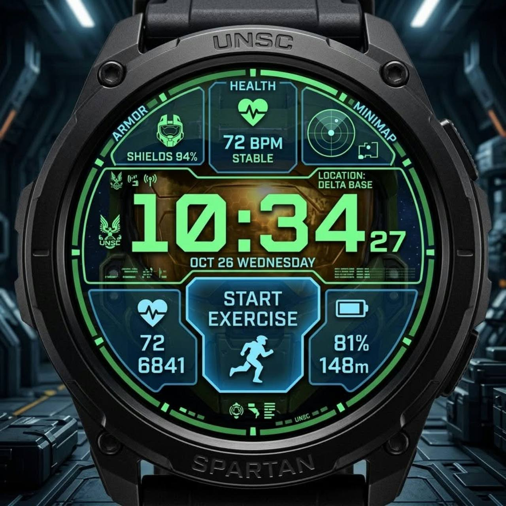

# HALO – Spartan Night

Állapot: **működő natív WFF 2 tesztszámlap, 0.1.5-test**. Cél: Galaxy Watch7.

A felhasználó a korábbi 03 – Spartan Night koncepciót választotta, majd a fenti
kép zöld–cián HUD-ja felé pontosította az irányt. A refencia vizuális cél,
nem egy elkészült alkalmazás képernyőképe.

Az idő legyen nagy, zöld és szögletes; az adatfelirat és alsó ikon jégcián.
Áttetsző, páncélháttérre rajzolt panelek követik a körívet. A fő időkeret és az
alsó középső gomb egymásba illő vállakat, utóbbi dupla kontúrt kap. A felső
ikonok sisak/szív/radar, az alsók cipő/futó/akku, a kis gombok célkereszt/adatsáv.
Ezek a kézi alapjelek; az automatikus HALO-párosítás a választott forrás neve
alapján módosíthatja őket.

Hat nagy panel és két gyorsgomb: mind a nyolc natív szerkeszthető adatmező.
A korábbi kilencgombos ötletet a WFF nyolcas korlátja miatt váltotta fel ez a
felhasználó által elfogadott kiosztás. A Nincs minden panelréteget elrejt.
Nincs beégetett appindító-lista; a natív appparancsikon választója használható.

A képen látható fizikai fémlunetta nem állítható elő egy kijelzőn. A számlap
vékony, kapcsolható grafit digitális keretet és zöld HUD-gyűrűt kínál.
A radar dekoráció, a sisakos ARMOR-mező alapforrása akkumulátor, nem pajzsmérés.
Always-on módban kizárólag kis, vékony idő látszik fekete háttéren.

Nyitott: Watch7-es visszaellenőrzés az új appnevekkel és adatmezőcímekkel,
az olvashatósági javítások igazolása és valós fogyasztáspróba.
