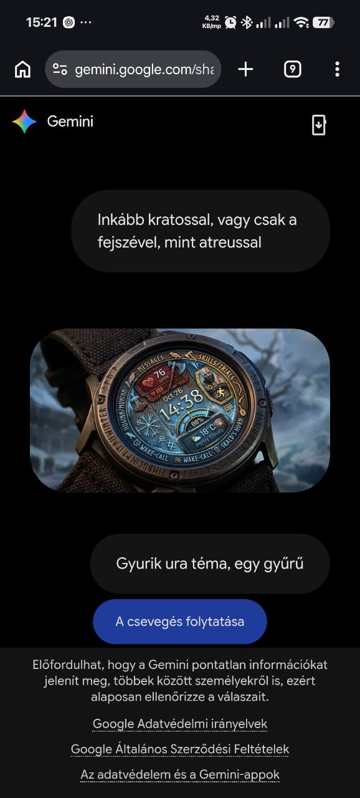

# God of War – Kratos / balta

Állapot: **dizájn- és fejlesztési terv; nincs APK**.

A felhasználói irány Kratos vagy a balta legyen; Atreus ne legyen főmotívum.
Jeges kék/türkiz felület, kopott bronz/acél, visszafogott vörös részlet és rúnás
perem illik hozzá. A középső idő nagy és olvasható maradjon; a díszítés ne
kerüljön a számokra. Balta/rúna/szív/lépés/akku saját ikonlap készüljön.

Tervezett funkció: legfeljebb nyolc natív mező, cserélhető adat és appparancsikon,
kikapcsolva eltűnő keret, témához rajzolt automatikus ikonpárosítás és külön AOD.
A rúnás grafika nem élő játékstatisztika. A mozgó jég/szikra csak későbbi,
opcionális aktív mód lehet, ha az olvashatóság és fogyasztás engedi.

Első lépések: sík számlaprajz tok nélkül; két színváltozat; saját ikonlap;
450-es geometria 432/480 px ellenőrzéssel; majd közös WFF-funkciók bekötése.
Elfogadás: Kratos/balta felismerhető, az idő és adatértékek teljesek, a körhöz
igazított panelek nem fedik egymást, a natív választó és Nincs állapot működik.
