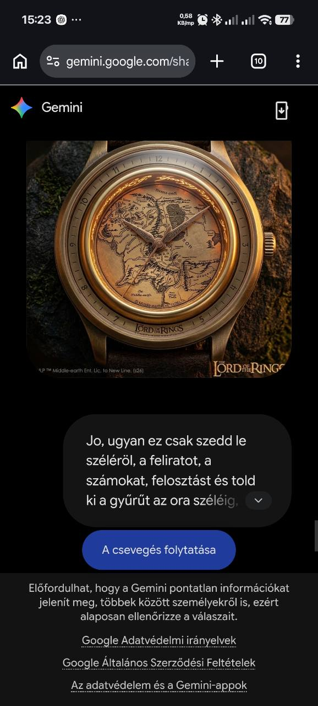
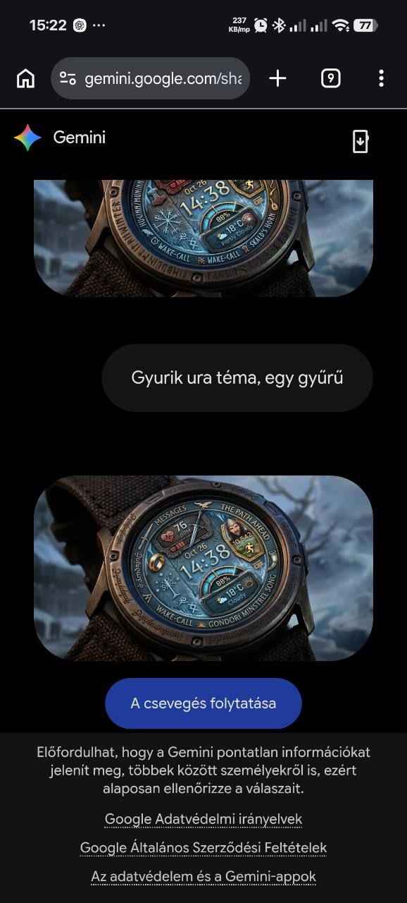

# Gyűrűk Ura – Egy Gyűrű és Középfölde

Állapot: **One Ring Classic – külön WFF2 teszt-APK a `feat/lotr-one-ring` ágon; nem kiadáskész és nincs órán ellenőrizve.** A HUD-verzió továbbra is dizájnterv.

## Egy Gyűrű – analóg

Pergamenszínű Középfölde-térkép, az óra széléig kihúzott arany gyűrű,
karcsú, valóban járó analóg mutatók. A 2026. október 20-i felhasználói módosítás
alapján az arany lünettán ismét szerepel az **1–12 óraszámozás**, a könnyebb
időleolvasáshoz. A számok álló tájolásúak, kis arany mezőkön; közöttük megmarad
a díszítő gravírozás. Percosztás és külső márkafelirat nincs.
A térkép és a gyűrű külön réteg, a mutatók nem lehetnek háttérre égetve.

Kevés, elrejthető adatmező célszerű, hogy a térkép ne váljon zsúfolttá.
Opciók: arany fényerő, térkép sötétítése, másodpercmutató, ambient egyszerűsítés.
A gyűrűfény dekoráció, nem állandó, nagy fogyasztású animáció.

## Középfölde – adatmezős HUD

Kékes térképréteg, bronz íves keretek, középen digitális idő. Saját ikonok:
levél, pajzs, vándor, csillag, gyűrű; a valódi pulzus/lépés/akku szerepük
olvasható maradjon. A nevek és dekorációk nem valós GPS- vagy játékadatok.

Első lépések: a két változatból külön síkrajz, mutató- és ikonlap,
olvashatósági próba, majd döntés a külön APK-ról. Mindkettőhöz önálló
WFF-, memória- és készülékes ellenőrzés kell a kiadás előtt.

## One Ring Classic – fejlesztői teszt

- **PR:** [#4 – One Ring Classic](https://github.com/fuloplevente1998/WearOS-Szamlap/pull/4) (draft, main érintetlen).
- **Csomagnév:** `hu.fuloplevente.oneringwatchface`, modul: `:lotrwatchface`, verzió: `0.1.0-test` / `1`.
- A gyűrű és a pergamentérkép saját, külön rasterizált grafikai réteg. A térkép stilizált illusztráció, nem az eredeti referencia egy az egyben.
- Az óra, perc és másodperc natív analóg mutatók, nem a háttérképre vannak rajzolva.
- Öt külön natív, szerkeszthető komplikáció: akkumulátor (12), pulzus (9), lépések (3), dátum (6), alkalmazásindító (4:30).
- A `WatchFaceInfo.Preview` és az APK-ikon a 432 px-es, aktuális aktív számlap-előnézetet használja; nem a referenciaképet. **A generált előnézetek mintaadatokat tartalmaznak és nem valós óraképernyőképek.**
- A grafikai előnézeteket a `scripts/render-lotr-previews.cjs` előállítja 432/480 px-es aktív/AOD méretben, miközben a betűk kiférését ellenőrzi.
- Az APK a GitHub Actions `Wear OS checks` futás `lotr-one-ring-*` artifactjaként érhető el. Ez CI debugkulccsal aláírt APK, nem garantáltan frissíti a későbbi, eltérő kulccsal aláírt példányt.

### Galaxy Watch7 próba – ha az óra fel van töltve

1. Telepítsd a **LOTR** APK-t az órára (nem a `wearos-*` HALO artifactot), és válaszd a `One Ring · Classic · Test` számlapot.
2. Ellenőrizd a mozgó óra-/percmutatót, a másodpercmutatót és azt, hogy az aranygyűrű valóban a kijelző széléig ér.
3. Nyisd meg a Testreszabás / Adatmezők menüt; válassz pulzus-, lépés-, akkumulátor- és dátumforrást. Az `EDZÉS` mezőnél válaszd az órára telepített edzésalkalmazás parancsikonját, például TrainPilotot.
4. Ellenőrizd a pulzus/lépések frissülését, az akku és a dátum helyességét, a koppintásokat és a `Nincs` esetben eltűnő mezőket.
5. Kapcsold az órát Always-on módba. Az AOD-ban ne jelenjenek meg a mintagrafikai adatmezők vagy a másodpercmutató; a két analóg főmutató maradjon olvasható.
6. Készíts aktív és AOD képernyőképet és jegyezd fel a szokatlan levágást, eltolt mutatókat vagy rosszul megnyíló edzésalkalmazást.

**Nem helyettesíthető CI-vel:** valódi forrásadatok átadása, kattintások, 432/480 fizikai megjelenés, órás olvashatóság és fogyasztási próba. A PR csak az órás visszajelzések után legyen merge-elhető.
