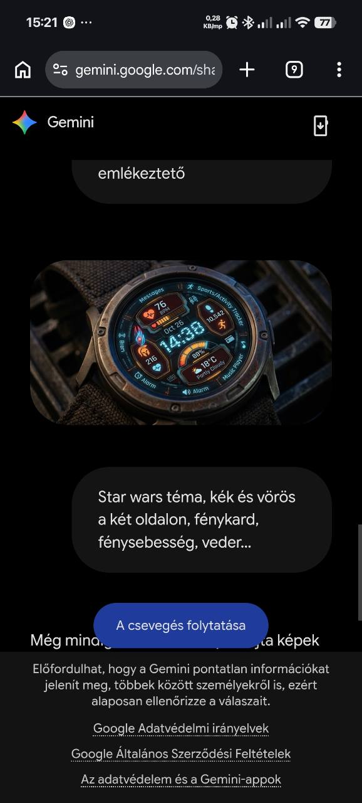

# Star Wars – kétoldalas űr-HUD

Állapot: **dizájn- és fejlesztési terv; nincs APK**.

Ez a kép egy korábbi sci-fi HUD kiindulópontja és a Star Wars-ötletet tartalmazó
képernyőkép, nem kész Star Wars-számlapterv. A kérés: bal/jobb oldalon kék és
vörös fénykardos irány, sötét űrháttér, Vader-motívum és fénysebesség-hangulat.

A két szín a körívet követő oldalsávokon és panelkereteken jelenjen meg,
középen kontrasztos, nagy idővel. A saját sisak-, kard-, hajó- és droidjelképek
tematikus ikonlapot kapjanak. A pulzus/lépés/akku továbbra is valódi adat;
a fénysebesség és célkereszt grafikai motívum, nem sebesség- vagy radarígéret.

Legfeljebb nyolc natív mező, teljesen elrejthető panelek és témához igazított
ikonpárosítás legyen. AOD-ban a háttér és effekt eltűnik. Csillagcsíkos átmenet
legfeljebb későbbi, kikapcsolható aktív effekt lehet.

Első lépések: kétoldalas színpaletta és síkrajz, saját ikonkészlet, álló
háttérváltozat, majd natív megvalósítás a közös alapra. Kiadás előtt külön
432/480 px, WFF-, memória- és Watch7-próba szükséges.
